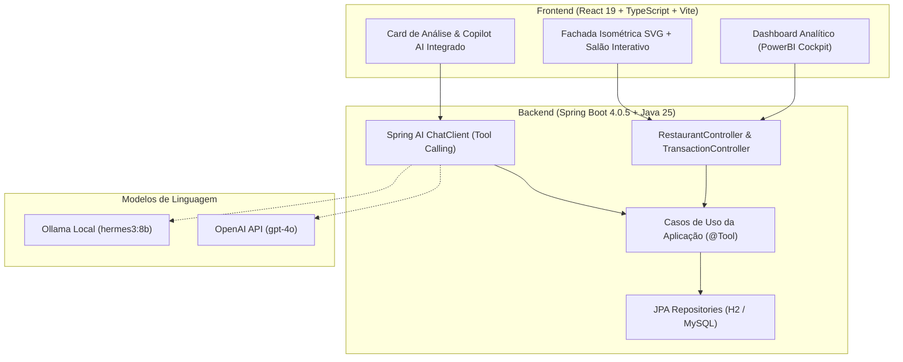

# DIO Spring Boot - Final Project 05: Spring AI (budgeting)

## Introduction

This final module applies Spring AI in a budgeting API while preserving the same layered architecture used across the track.

The goal is to integrate AI capabilities without bypassing domain and use case boundaries.

## Code Context

The project processes voice commands to create and query financial transactions.

Primary flow:

1. Client uploads an audio file.
2. Audio is transcribed into text.
3. The model selects an application tool/use case.
4. The use case persists or queries transaction data.
5. The final response is converted to audio.

## Project Structure

- `src/main/java/dio/budgeting/domain`
  - Domain model and repository contract.
- `src/main/java/dio/budgeting/application`
  - Use cases used by both REST and AI tool calling.
- `src/main/java/dio/budgeting/infrastructure`
  - HTTP adapters, JPA adapters, and integration glue.

## Module-Specific Topics

### Speech-to-text

- Uses `TranscriptionModel` for audio transcription.
- Model settings are configured in `application.properties`.

### Tool calling

- `ChatClient` registers use-case tools.
- `@Tool` methods expose business capabilities to the model.

### Text-to-speech

- `TextToSpeechModel` produces MP3 output from final text.
- AI endpoint returns generated audio.

## Spring AI Documentation

- Spring AI Reference: https://docs.spring.io/spring-ai/reference/index.html
- ChatModel API: https://docs.spring.io/spring-ai/reference/api/chatmodel.html
- ChatClient API: https://docs.spring.io/spring-ai/reference/api/chatclient.html
- Tools API: https://docs.spring.io/spring-ai/reference/api/tools.html
- Audio Transcriptions API: https://docs.spring.io/spring-ai/reference/api/audio/transcriptions.html
- Audio Speech API: https://docs.spring.io/spring-ai/reference/api/audio/speech.html

## Shared Architecture References

Common architecture concepts are documented in the root README:

- [DDD layers](../README.md#ddd-layered-architecture)
- [Class vs record](../README.md#java-class-vs-java-record-in-domain-modeling)
- [Strong typed identifiers](../README.md#strong-typed-identifiers)
- [Repository pattern](../README.md#repository-pattern)
- [Use cases and Clean Architecture](../README.md#use-cases-and-clean-architecture)
- [Docker Compose support](../README.md#docker-compose-support-in-development)

## How to Run

Set your OpenAI API key (optional if using local Ollama):

```bash
export OPENAI_API_KEY="your_api_key_here"
```

Run the application and tests:

```bash
./gradlew bootRun
./gradlew test
```

## Notes

- Educational final project focused on AI plus architectural discipline.
- External provider integration tests may require active credentials.

---

## 🏆 Entrega do Desafio Final: Kojiramen — Izakaya & AI Restaurant Management Cockpit


### 🍜 O que o projeto faz

O desafio final evoluiu a API original de orçamento para o **Kojiramen**: um sistema integrado de restaurante Izakaya com estética japonesa moderna e cockpit gerencial inteligente.

A aplicação unifica o atendimento de salão (clientes nas mesas) e a retaguarda gerencial (gestão e caixa). Clientes e operadores podem consultar o cardápio, abrir e fechar comandas por mesa, acompanhar o faturamento em tempo real através de um **Dashboard estilo PowerBI**, e interagir com um **Copilot AI integrado** munido de botões de análise rápida que orquestram casos de uso do backend via **Spring AI Tool Calling**.

Ao fechar a comanda de uma mesa, o sistema faz o lançamento contábil automático como uma transação financeira categorizada (`RAMEN`, `BITES`, `BEVERAGES`, `DESSERTS`, `SUPPLIES`).



---

### ✨ Inovações e Melhorias Implementadas

1. **Copilot AI Integrado no Card de Análise:**
   - O chat de inteligência artificial foi transformado em um assistente analítico integrado diretamente ao dashboard de gestão.
   - Em vez de um chat flutuante vazio que deixa o operador sem saber o que perguntar, o painel oferece **botões contextuais de análise guiada** (*Resumo das Vendas*, *Pratos mais pedidos*, *Status do Caixa*), permitindo que qualquer membro da equipe obtenha insights instantâneos sem atrito de digitação.

2. **Cockpit Gerencial & BI Analytics (PowerBI Style):**
   - **Cards de KPIs em Tempo Real:** Faturamento Total, Vendas Hoje, Ticket Médio e Mesas Ocupadas.
   - **Salão Interativo Simplificado:** Grid visual com as mesas do restaurante e status em tempo real (livre/ocupada).
   - **Card de Vendas por Categoria:** Gráfico visual em reais com categorias de restaurante traduzidas e padronizadas (`RAMEN`, `BITES`, `BEVERAGES`, `DESSERTS`, `SUPPLIES`).
   - **Detalhamento de Comandas e Extrato Contábil:** Tabela com histórico completo de comandas fechadas e auditoria financeira.

3. **Frontend Isométrico & Mascote Gojira:**
   - Arte vetorial isométrica customizada (`Storefront.tsx`) com janelas iluminadas, lanternas acesas e telhado interativo.
   - Integração do mascote oficial `gojira.png` no cabeçalho superior, no rodapé, na vitrine e na página de história.
   - Alternância fluida de contexto pelo seletor de perfil (`role-badge-toggle`: `🍜 Mesa` vs `🧑‍🍳 Gestão`).
   - Menus de navegação limpos e simétricos (Menu Superior: *Home*, *Cardápio*, *História*; Menu Lateral: *01 Início*, *02 Cardápio & Vitrine*, *03 História*).

4. **Spring AI & Tool Calling em Arquitetura Limpa:**
   - Os use cases de negócio implementados para a API REST foram anotados diretamente com `@Tool`:
     - `create-restaurant-order`: Abertura e acréscimo de pedidos na mesa.
     - `close-table-order`: Fechamento de comanda com cálculo e lançamento financeiro automático.
     - `list-restaurant-orders`: Listagem de comandas ativas por mesa.
     - `list-restaurant-menu`: Consulta aos pratos e bebidas cadastrados.
     - `summarize-transactions`: Resumo consolidado do faturamento e vendas por categoria.
     - `list-all-transactions`: Listagem analítica de todas as transações contábeis.
   - O modelo de IA nunca acessa o banco de dados diretamente: ele orquestra as mesmas regras de negócio e validações de domínio utilizadas pelos endpoints REST.

5. **Persistência Desacoplada e Resiliente:**
   - Configuração de banco de dados H2 persistente em arquivo local (`./data/kojiramen.mv.db`) operando em modo de compatibilidade com MySQL (`MODE=MySQL`).
   - O sistema inicializa instantaneamente em qualquer sistema operacional (Linux, WSL, macOS, Windows) sem depender de daemon Docker em execução, preservando dados entre reinicializações.
   - Suporte transparente ao MySQL em container caso o desenvolvedor opte por ativar o `compose.yml`.

---

### 🛠️ Tecnologias Utilizadas

- **Linguagem & Plataforma:** Java 25
- **Framework Principal:** Spring Boot 4.0.5
- **Inteligência Artificial:** Spring AI 2.0.0-M4 com Tool Calling
- **Persistência:** Spring Data JPA, Hibernate ORM 7, H2 Database (modo MySQL) e MySQL 8
- **Frontend:** React 19, TypeScript, Vite, SVG Isométrico, CSS moderno
- **Modelos de IA Suportados:** Ollama local (`hermes3:8b`, `qwen2.5:14b`) e OpenAI (`gpt-4o`, `gpt-3.5-turbo`)
- **Testes:** JUnit 5, Mockito, Spring Boot Test

---

### 🚀 Como Executar

#### 1. Pré-requisitos
- **Java 25** instalado e configurado no `PATH`.
- (Opcional) **Node.js 20+** e **pnpm/npm** (caso deseje recompilar o frontend).
- (Opcional) **Ollama** rodando localmente com o modelo `hermes3:8b`:
  ```bash
  ollama run hermes3:8b
  ```
  *Nota: Se preferir utilizar a OpenAI, basta exportar `export OPENAI_API_KEY="sua_chave"`.*

#### 2. Compilar o Frontend (Opcional — já pré-compilado nos recursos estáticos)
```bash
cd CoffeeShopWebsiteConcept
npm install
npm run build
rsync -av dist/ ../05-spring-ai/src/main/resources/static/
cd ..
```

#### 3. Iniciar o Spring Boot
```bash
cd 05-spring-ai
./gradlew bootRun --args='--server.port=8089'
```

A aplicação subirá na porta **8089** (ou 8080 se executada sem argumentos).

#### 4. Acessar no Navegador
Abra [`http://localhost:8089`](http://localhost:8089) no seu navegador:
- **Modo Mesa:** faça pedidos pelo cardápio e confira sua comanda em tempo real.
- **Modo Gestão:** clique no botão `🧑‍🍳 Gestão` no cabeçalho superior para acessar o Cockpit com KPIs, mapa do salão e o Copilot de Análise.

---

### 🧪 Roteiro de Testes e Validação

#### 1. Testes Automatizados
Execute a suíte de testes unitários e de integração:
```bash
./gradlew test
```
*Todos os testes da camada de domínio, casos de uso de restaurante e controller executam de forma independente de serviços externos.*

#### 2. Testes de API via cURL

- **Consultar Resumo Financeiro (KPIs):**
  ```bash
  curl -s http://localhost:8089/api/restaurant/summary
  ```

- **Consultar Cardápio Oficial:**
  ```bash
  curl -s http://localhost:8089/api/restaurant/menu
  ```

- **Fazer Pedido em uma Mesa:**
  ```bash
  curl -X POST http://localhost:8089/api/restaurant/orders \
    -H 'Content-Type: application/json' \
    -d '{"tableNumber": 3, "items": [{"itemName": "Kojira Shoyu Ramen", "quantity": 2, "unitPriceReais": 54.0}]}'
  ```

- **Consultar Pedidos Ativos da Mesa 3:**
  ```bash
  curl -s http://localhost:8089/api/restaurant/orders
  ```

- **Interagir com o Copilot AI via Chat:**
  ```bash
  curl -X POST http://localhost:8089/api/restaurant/chat \
    -H 'Content-Type: application/json' \
    -d '{"message": "Qual é a situação das comandas abertas e quanto faturamos hoje?"}'
  ```

- **Fechar a Mesa 3 e Lançar Venda Contábil:**
  ```bash
  curl -X POST http://localhost:8089/api/restaurant/orders/3/close
  ```

- **Auditar Transações Contábeis Registradas:**
  ```bash
  curl -s http://localhost:8089/transactions
  ```

---

### 💡 Principais Aprendizados do Desafio

1. **Paridade entre APIs REST e Agentes de IA:**
   Ao modelar casos de uso desacoplados e anotá-los com `@Tool`, tanto um controller HTTP tradicional quanto o Spring AI ChatClient consomem exatamente a mesma lógica de negócio, garantindo integridade de dados e validações idênticas.
2. **Design de Experiência (UX) para LLMs corporativas:**
   Usuários de sistemas corporativos frequentemente enfrentam bloqueio diante de caixas de chat vazias. Oferecer botões contextuais de análise guiada orienta o operador sobre as capacidades reais da IA e reduz drasticamente alucinações.
3. **Robustez de Tipos Primitivos em Tool Calling:**
   Modelos menores locais (como os executados via Ollama) têm desempenho muito superior quando as ferramentas recebem parâmetros primitivos claros (`tableNumber`, `amountReais`, `notes`), delegando cálculos monetários e conversões de unidade ao código Java.
4. **Resiliência Arquitetural de Persistência:**
   A adoção do H2 em arquivo com emulação de dialeto MySQL conferiu portabilidade total ao projeto, garantindo funcionamento contínuo e sem atrito para qualquer avaliador ou desenvolvedor.
